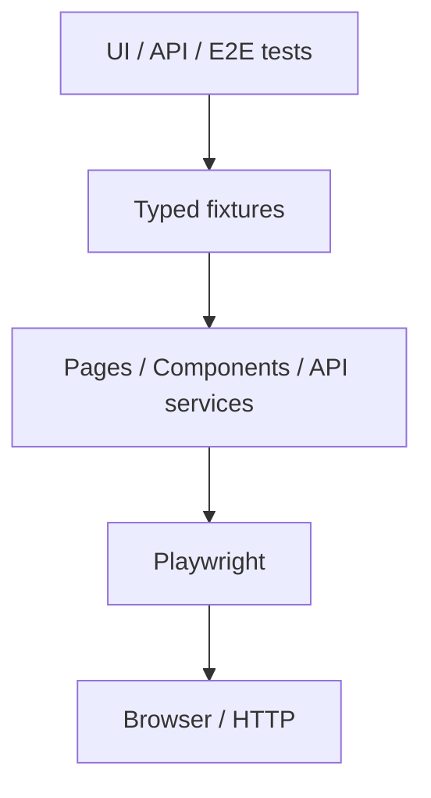
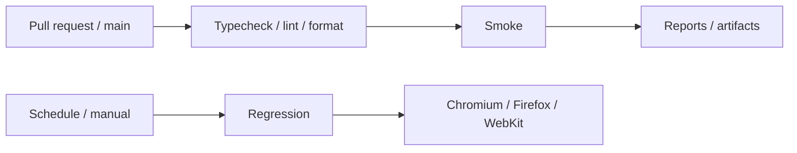

# Playwright Test Automation Template

[](https://github.com/ahmetkemalsari/playwright-test-automation-template/actions/workflows/playwright.yml)
[](https://github.com/ahmetkemalsari/playwright-test-automation-template/actions/workflows/nightly-regression.yml)
[](https://github.com/ahmetkemalsari/playwright-test-automation-template/actions/workflows/codeql.yml)
[](https://playwright.dev/)
[](https://www.typescriptlang.org/)
[](LICENSE)

## Overview

Reusable, production-oriented starter kit for isolated UI, API, and end-to-end tests. Bundled SauceDemo and JSONPlaceholder scenarios live in `src/examples/demo` as executable examples—not framework dependencies. Replace that namespace when adopting the template.

## Features

- Strict TypeScript, typed fixtures, Page/Component Objects, and typed API models
- dev/staging/prod configuration with fail-fast validation and a production safety lock
- Chromium, Firefox, WebKit, API-only projects, parallel execution, and CI retries
- Reusable authentication through Playwright `storageState`
- HTML and JUnit reports plus failure screenshots, video, and traces
- ESLint, Prettier, Docker, PR checks, and nightly cross-browser regression

## Tech Stack

Node.js 20+, TypeScript, Playwright Test, npm, ESLint flat config, Prettier, dotenv, Docker, and GitHub Actions.

## Architecture

Tests express business flows. Typed fixtures inject page objects and API services. Page/component objects own selectors, services own endpoints, and `config/environment.ts` owns runtime configuration. Utilities remain small, focused functions.



## Folder Structure

```text
config/                 environment selection and examples
playwright/fixtures/    typed UI and API dependency injection
playwright/.auth/       generated storage state (gitignored)
src/pages/              framework-level page primitives
src/api/clients/        shared API client primitives
src/examples/demo/      replaceable demo UI, API, models, and data
src/utils/              focused utilities
tests/setup/            authentication setup project
tests/ui/               smoke and regression UI tests
tests/api/              smoke and regression API tests
tests/e2e/              cross-layer business flows
```

## Prerequisites

- Node.js 20 or newer
- npm 10 or newer
- Docker (optional)

## Installation

```bash
npm install
npx playwright install
cp .env.example .env
npm run test:smoke
```

On PowerShell, use `Copy-Item .env.example .env`.

## Environment Configuration

`TEST_ENV` selects `dev`, `staging`, or `prod`. The loader first reads `config/environments/<environment>.env`, then `.env`, while existing shell variables win. Copy an example and supply:

```env
BASE_URL=https://example.com
API_BASE_URL=https://api.example.com
TEST_USERNAME=test-user
TEST_PASSWORD=replace-me
LOG_LEVEL=info
```

Real `.env` files are ignored. Missing required values fail before tests begin. Production requires both `ALLOW_PROD_TESTS=true` and `PROD_CONFIRMATION=RUN_NON_DESTRUCTIVE`. Destructive production tests remain unsupported until an adopting team adds a separate domain-specific guard.

## Running Tests

```bash
npm test
npm run test:dev
npm run test:staging
npm run test:prod
```

## Smoke Tests

`npm run test:smoke` runs tests tagged `@smoke` on Chromium and the API project.

## Regression Tests

`npm run test:regression` runs `@regression` across configured projects and browsers.

## UI Tests

Use `npm run test:chromium`, `test:firefox`, `test:webkit`, `test:headed`, or `test:ui`.

## API Tests

`npm run test:api` runs API-tagged specs without launching a browser.

## E2E Tests

`npm run test:e2e` runs end-to-end flows on Chromium.

## Browser Selection

Local default scripts favor Chromium for speed. Nightly CI runs Chromium, Firefox, and WebKit. Direct Playwright options also work: `npx playwright test --project=firefox`.

## Authentication

The `setup` project writes `playwright/.auth/user.json`. Authenticated browser projects depend on it. The separate `chromium-public` project runs login tests with empty state and no setup dependency. Auth files are ignored and are outside uploaded report/result paths.

For multiple roles, add one auth path per role (for example `admin.json` and `readonly-user.json`) and narrowly matched projects that select those states. Do not create unused demo roles.

## Page Object Model

Page objects contain locators and page behavior; `BasePage` contains only shared navigation. Components model repeated UI regions. Tests never instantiate these objects directly.

## Component Objects

Reusable regions such as headers and navigation are isolated in `src/examples/demo/components`. Product implementations should create their own namespace and expose owning pages through fixtures.

## Custom Fixtures

Import the appropriate fixture and request dependencies by name:

```typescript
test('example', async ({ loginPage, dashboardPage }) => {
  await loginPage.open();
  // business flow
});
```

## API Architecture

`BaseApiClient` owns shared request concerns. Domain services such as `UserApi` own endpoint paths and return Playwright responses. Typed models describe request and response bodies; tests assert status and important payload fields.

For APIs that persist data, use a test-scoped cleanup registry: register IDs immediately after creation and delete in fixture teardown in reverse order. The public demo API does not persist writes, so no fake cleanup implementation is included.

## Test Data Factory

`UserFactory.create()` returns valid defaults; `UserFactory.create({ role: 'ADMIN' })` applies typed overrides. Unique values are simple and local to the process.

## Tagging Strategy

Native tags are: `@smoke`, `@regression`, `@ui`, `@api`, `@e2e`, `@critical`, and `@negative`. Combine them in test metadata and select them with `--grep`.

## Debugging

Run `npm run test:debug` or `npm run test:headed`. Failures retain trace, video, and screenshot artifacts under `test-results/`.

## Trace Viewer

```bash
npx playwright show-trace test-results/artifacts/<test-folder>/trace.zip
```

## Reports

HTML is written to `playwright-report/`; JUnit XML is written to `test-results/results.xml`. Open the HTML report with `npm run report`.

## Docker Usage

Copy `.env.example` to `.env`, then:

```bash
docker compose run --rm playwright npm run test:smoke
```

The image uses Microsoft's version-matched Playwright image and mounts reports back to the host.

## CI/CD

Pull requests and pushes to `main` run install, lint, formatting, type checking, and smoke tests. Reports and test artifacts upload even after failures. npm caching is enabled.



## Nightly Regression

The scheduled workflow runs daily at 02:00 UTC and can be started manually. It installs all browsers and runs cross-browser regression.

The suite is sharding-ready when its size justifies it: `npx playwright test --shard=1/4`. Sharding is intentionally omitted from the small default CI matrix.

## Writing Your First Test

Choose the UI, API, or E2E folder, import its fixture, add native tags, and write a business-readable flow. Keep each test independently runnable and clean up created data when the target API persists it.

## Adding a New Page Object

Create a product namespace under `src`, keep locators private, expose business actions/assertions, then construct the page once in `base.fixture.ts` and add its type to `UiFixtures`.

## Adding a New API Service

Add request/response types and a service under your product namespace, reuse `BaseApiClient` only where it adds value, and expose the service through `api.fixture.ts`. Do not recreate the entire Playwright request API.

## Adding a New Fixture

Extend the narrowest fixture type, construct the dependency in the fixture callback, call `use`, and import that fixture in relevant specs. Avoid fixture dependency chains unless lifecycle requires them.

## Best Practices

- Prefer independent, parallel-safe tests and web-first assertions.
- Never use fixed sleeps; rely on Playwright auto-waiting.
- Keep credentials, tokens, and storage state out of source control and logs.
- Keep selectors and endpoints outside test files.
- Do not use retries to hide flaky tests.

## Locator Strategy

Prefer role, label, placeholder, text, test id, CSS, then XPath—in that order. XPath is a last resort. Locators belong in Page or Component Objects.

## Environment Variables

`BASE_URL`, `API_BASE_URL`, `TEST_USERNAME`, and `TEST_PASSWORD` are required. `TEST_ENV`, `LOG_LEVEL`, and `TEST_ID_ATTRIBUTE` are optional. Production additionally requires both explicit confirmation variables described above.

## GitHub Secrets

Bundled workflows use the documented public SauceDemo example account and require no repository secrets. Product repositories must replace those values with `TEST_USERNAME` and `TEST_PASSWORD` Actions secrets and should configure environment URLs as variables.

## Security

- `.env`, auth state, reports, traces, screenshots, and videos are ignored.
- Never log or upload credentials, authorization headers, tokens, or storage state.
- Included credentials are public SauceDemo example values and must be replaced.
- Workflows use least privilege; CodeQL and monthly Dependabot checks are included.

See [GitHub publication guidance](docs/GITHUB_SETUP.md) and [v1.0.0 release notes](docs/RELEASE_NOTES_v1.0.0.md).

## Troubleshooting

- Missing variable: create `.env` from the example.
- Browser executable missing: run `npx playwright install --with-deps`.
- Auth failure: delete `playwright/.auth/user.json` and rerun; setup regenerates it.
- Target unavailable: verify `BASE_URL`, `API_BASE_URL`, proxy, and firewall settings.
- Inspect a failure with the HTML report and retained trace before adding retries.

## Contributing

Read [CONTRIBUTING.md](CONTRIBUTING.md) and run `npm run lint`, `npm run format:check`, `npm run typecheck`, and the relevant tests before opening a pull request.
